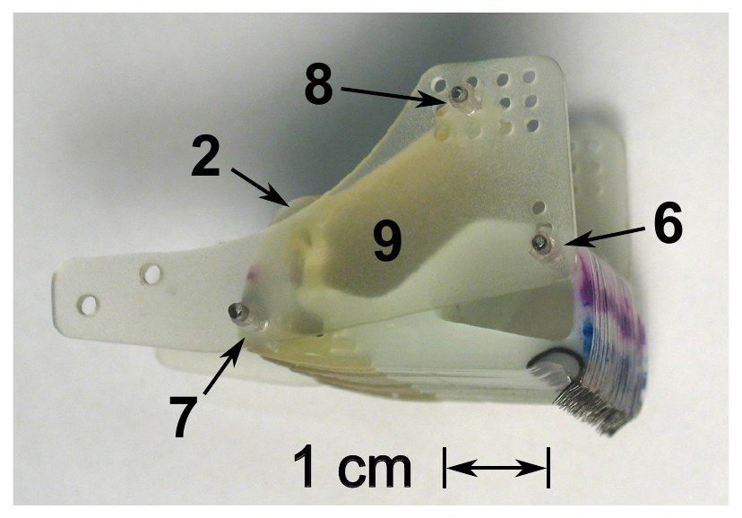
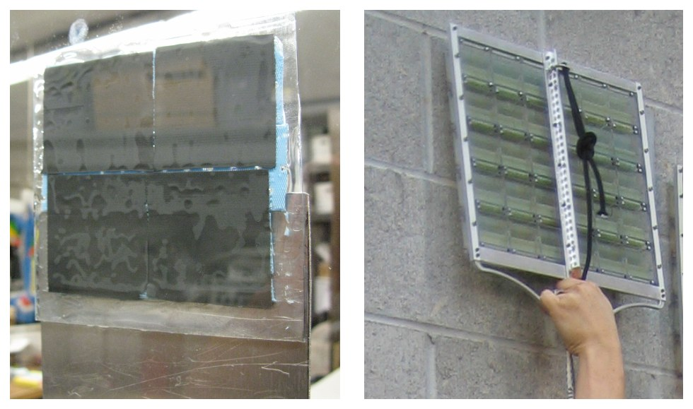

# Arrays, feet and large patches

A robot foot needs tens of spines. A person needs more than a thousand. Getting from one toe to an array raises problems that a single toe does not have.

## One row: a foot

A row is a stack of toes on three pins held between two side plates.

*A group of RiSE toes assembled into a foot. Pins 6, 7 and 8 pass through every toe and are carried by the side plates (9). Figure 4.3 of [Asbeck 2010][asbeck2010], © Alan T. Asbeck, [CC BY-NC-ND 3.0 US](https://creativecommons.org/licenses/by-nc-nd/3.0/us/).*

Within a row the toes are independent except for two things:

- **Friction between neighbours.** Flat toes slide against each other. If the normal spring is too weak they stick together and move in clumps, and a clump behaves like one fat, stiff toe. This sets the lower limit on normal stiffness.
- **Tangling.** A toe that springs back from a slip can land on its neighbour. The overload pin and the steep rear flexure prevent it ([Toe designs](toe-designs.md#overload-protection)).

The width of a row is the number of toes times their thickness. A foot much wider than the limb that carries it is hard to keep parallel to the wall, and its ends dig in when it is not.

## Preload adds up

Every toe has to be pressed against the wall to seat it, and the force needed is proportional to the number of toes. Ten RiSE toes needed about 0.04 N on an angled approach. A robot foot of 20 to 30 spines needs about 0.1 N. A human-scale patch of thousands needs up to 10 N ([Asbeck 2010][asbeck2010], §4.6.1).

That force does not come for free. While one patch is being pressed on, the reaction has to be carried as extra adhesion by the patches that are already holding, and their adhesion is limited by the shear they carry, which is limited by the weight of the climber. Preload therefore comes straight out of the safety margin. For large arrays, normal stiffness must be as low as friction between toes allows, and a patch should be brought on at an angle and dragged, not pushed straight in: the same ten toes needed five times the preload when pressed in perpendicularly.

## Several rows: the alignment problem

Put several rows on one rigid plate and a new difficulty appears: the plate has to lie flat on the wall for every row to reach it. In practice it does not.

With patches of directional dry adhesive on rigid backings, typically only 50 to 80 % of the area makes contact, even when the patch is aligned to within a fraction of a degree. With the Z-Man climbing paddles, which carried several rows of spine toes on a rigid plate, far fewer spines engaged in the lower rows than in the top row ([Asbeck 2010][asbeck2010], §5.1).

*Left: a patch of hierarchical dry adhesive seen through the glass it is stuck to; grey is in contact, black is not. Right: a Z-Man climbing paddle, with rows of spines on a rigid backing. Figure 5.2 of [Asbeck 2010][asbeck2010], © Alan T. Asbeck, [CC BY-NC-ND 3.0 US](https://creativecommons.org/licenses/by-nc-nd/3.0/us/).*

The cause is a moment. The forces on the face of a patch are never uniform, so their resultant does not pass through the point where the patch is loaded from behind. The offset is a moment on the patch. The patch rotates, one edge is pressed in and the other is lifted, the lifted elements let go, the load on the rest rises and shifts, and the offset grows. Unless something stops it, the patch peels.

*Why lower rows let go. A load that does not act close to the wall turns the plate about its top rows.*

## The patch as a mechanics problem

Chapter 5 of the thesis analyses a simple case: a patch on a rigid backing, loaded through a ball joint that sits a distance $x_j$ behind the face and carries a torsion spring. Each element of the patch, a spine or an adhesive stalk, holds up to $F^*$ at up to $\theta_{max}$ from the surface.

### Side to side

Viewed from above, only the normal force matters. Suppose the resultant on the face is offset sideways from the joint by $d_z$. For a patch of width $w_z$ whose elements have stiffness $\kappa$ per unit width, with a joint spring $k_\psi$, the largest normal force $F_n$ the patch can carry satisfies

$$
\frac{6\,\kappa\,w_z\,d_z\,F_n}{12\,F_n\,x_j + 12\,k_\psi + w_z^3\,\kappa} + \frac{F_n}{w_z} \;\le\; \gamma_{max}
$$

where $\gamma_{max}$ is the normal force per unit width at which elements let go. The second term is the load if it were spread evenly. The first is the penalty for the offset. It shrinks when:

- the joint spring $k_\psi$ is **stiffer**;
- the patch is **wider**, strongly, through $w_z^3$;
- the elements are **softer** (smaller $\kappa$), because the patch can then tilt further before the most loaded edge gives up;
- the joint is **farther from the wall**. Treat this one with caution: a long standoff also multiplies any error in the direction of the load.

This direction is unstable by nature. Whichever way the patch tilts, it gets worse. Only the joint spring and the geometry hold it.

### Top to bottom

In the vertical plane there is shear as well as normal force, and here the instability can be turned around. The recipe ([Asbeck 2010][asbeck2010], §5.3.2):

*Stable engagement: where to put the joint.*

1. **Tilt the patch forward a few degrees** so that its top edge always touches first. The resultant on the face then starts near the top.
2. **Put the joint below that resultant and outside the $\theta_{max}$ line.** Draw a line from the point where the wall force acts, at $\theta_{max}$ from the wall. With the joint on the far side of that line, any load between pure shear and $\theta_{max}$ rotates the patch the same way: toward the wall. Loading the patch now presses more of it on.
3. **Keep the joint close to that line.** The farther beyond it, the larger the moment the spring and the patch must absorb.
4. **Size the torsion spring** so that at the largest load, in pure shear, the patch has rotated just parallel to the wall.
5. **Keep the standoff $x_j$ short.**

The microwedges of a directional adhesive do this at the scale of a single stalk: each starts inclined, touches at its tip, and lays down as it is loaded. The recipe applies the same idea to the whole patch.

### What holds the patch matters

A patch on a stiff test stage is held parallel to the surface by force, and gives the best numbers it ever will. A patch on a robot limb is held less rigidly. A patch in a **human hand** is on a soft support: it rotates under preload, which helps it seat, and it rotates under load, which can peel it. The Z-Man paddles were held this way.

## What helps in practice

- **Keep the line of action of the load close to the wall.** A long tether from the patch to a point far below it does this. A short handle that stands off the wall does the opposite.
- **Prefer wide to tall.** The side-to-side analysis favours width strongly. A patch that is short from top to bottom is probably better too, since it tolerates more tilt for the same reach of its elements, though the thesis leaves that point open.
- **Let rows float.** Break the rigid backing into strips or tiles that can each find the wall, and share the load between them with a mechanism designed for it. Later human-scale hands and palms do exactly this, dividing shear among spine tiles with tendons or pulley differentials ([Wang 2016][wang2016]; [Wang 2019][wang2019]; [Ruotolo 2019][ruotolo2019]), an idea developed in parallel for gecko-adhesive tiles ([Hawkes 2015][hawkes2015]).
- **Soften the elements normal to the wall.** This forgives both misalignment and waviness.
- **Lower the profile.** A suspension that stands less far off the wall shortens every moment arm.
- **Lighten it.** The thesis singles out the weight of the human climbing system as a significant problem.

## Denser arrays

The RiSE-style toe is long compared with its width, so rows cannot be stacked closely. For heavy robots a different unit was developed at Stanford: a **linearly constrained spine** that slides normal to the surface in a housing, soft in that direction and stiff against side and bending loads ([Wang 2016][wang2016]; [Wang 2017][wang2017]). Reported results:

| Quantity | Value | Source |
|---|--:|---|
| Spine density | 19 per cm² | [Wang 2016][wang2016] |
| Mean adhesion of the mechanism on coarse concrete | 67 N (207 kPa) | [Wang 2016][wang2016] |
| Palm size | 120 × 100 mm, 12 spine tiles | [Wang 2016][wang2016] |
| Mean shear on concrete blocks, whole palm | up to 710 N (183 kPa) | [Wang 2016][wang2016] |

A statistical model of such arrays, in which the surface is described by a distribution of asperities and the array by its compliance, predicts force capability over a range of loading directions for single and opposed arrays ([Jiang 2018][jiang2018]).

## Open problems

- A suspension for many rows that is as well understood as the single row.
- Flexible backings and spines of graded length across a patch, both suggested in the thesis and not, as far as this wiki knows, systematically tested.
- Measured data on how engagement varies from row to row.

See [Open questions](../reference/open-questions.md).

[asbeck2010]: ../reference/bibliography.md#asbeck2010
[wang2016]: ../reference/bibliography.md#wang2016
[wang2017]: ../reference/bibliography.md#wang2017
[wang2019]: ../reference/bibliography.md#wang2019
[ruotolo2019]: ../reference/bibliography.md#ruotolo2019
[hawkes2015]: ../reference/bibliography.md#hawkes2015
[jiang2018]: ../reference/bibliography.md#jiang2018
