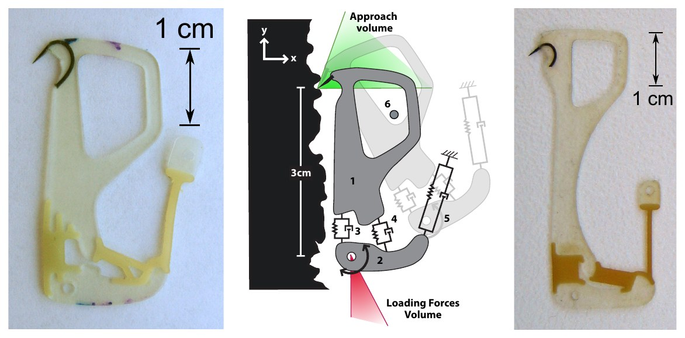
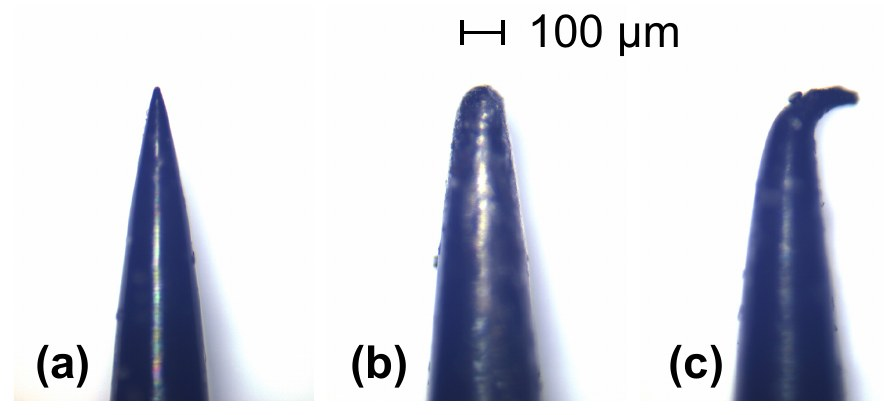
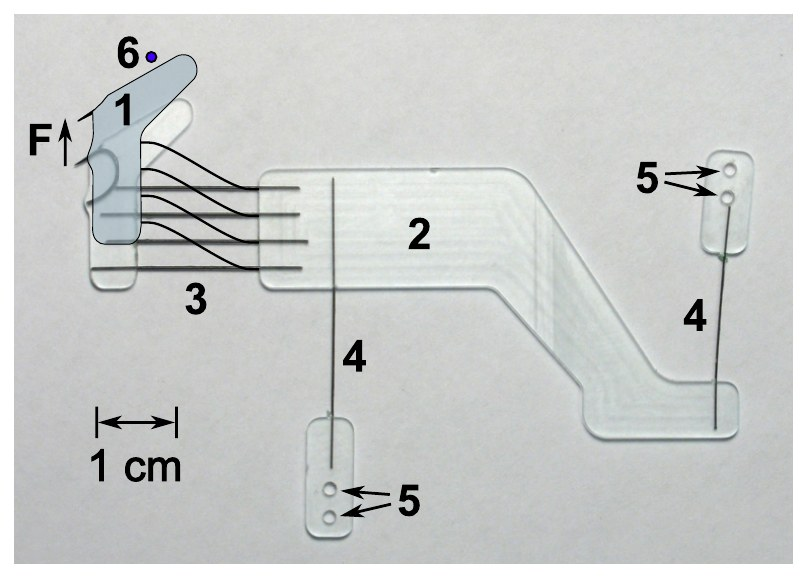

# Toe designs

A **toe** is one spine with its suspension. Toes are flat and thin, and are stacked side by side on pins to make a **foot**. The best documented design is the one developed for the RiSE robot and enlarged for Z-Man human climbing ([Asbeck 2010][asbeck2010], §4.2.2; [Asbeck & Cutkosky 2012][asbeck2012], §5.1).

## The RiSE and Z-Man toe

*Functional schematic of the toe, not to scale. The numbering follows the thesis.*

| Part | What it is | What it does |
|--:|---|---|
| 1 | Hard body with a steel hook cast into it | Carries the spine and keeps it at a fixed angle |
| 2 | Rigid link at the base | Turns about pin 7; the lever that the normal flexure acts on |
| 3, 4 | Two flexures between body and link | Stretch along the wall. Together they are the axial spring of the [stalk model](stalk-model.md). Stiff in bending, so the body cannot fold over |
| 5 | Long, soft flexure from the link to pin 8 | Normal compliance. Stretched at rest, it turns the whole toe gently toward the wall |
| 6 | Pin through a window in the body | Overload stop, travel limit and anti-tangle guard |
| 7 | Pin through the link | The pivot |
| 8 | Pin through the end block of flexure 5 | Anchors the normal flexure |
| 9 | Side plates (not drawn) | Hold pins 6, 7 and 8 at each end of a row of toes |

*Left: a RiSE toe. Centre: its spring–damper model. Right: a Z-Man toe, the same design with different lengths and stiffer flexures. Figure 4.2 of [Asbeck 2010][asbeck2010], © Alan T. Asbeck, [CC BY-NC-ND 3.0 US](https://creativecommons.org/licenses/by-nc-nd/3.0/us/).*

### How it moves

**Pressed toward the wall**, the body swings back about pin 7, against flexure 5. Because flexure 5 works in tension, not compression, it can be made very soft without buckling, and the force on the wall stays tiny.

**Dragged down the wall** after the hook has caught, pins 6, 7 and 8 move down with the foot while the body stays with the hook. Flexures 3 and 4 stretch. With the right stiffnesses the link also rotates forward as they stretch, which slackens flexure 5: the toe presses on the wall less as it takes up load. That helps both load sharing and re-engagement, and it brings the foot closer to the wall, the $k_{xy} < 0$ behaviour asked for in [What the suspension must do](suspension-requirements.md).

**At rest**, flexure 5 would rotate the toe forward into the wall side, but pin 6 stops it against the edge of its window. This leaves the tip preloaded toward the wall by a small, well-defined amount.

### Measured properties of the RiSE toe

| Property | Value | Source |
|---|--:|---|
| Length, pivot to spine tip | 3.0 cm | thesis §4.2.2 |
| Shear stiffness, flexures 3 and 4 in parallel | 184–191 N/m | thesis Fig. 4.2; paper §5.1 |
| Shear damping | 0.42 N·s/m | both |
| Stiffness of flexure 5 | 10–16 N/m | paper §5.1; thesis Fig. 4.2 |
| Travel along the wall before the overload stop | 9–11 mm | paper §5.1 |
| Travel normal to the wall | about 8 mm | thesis §4.2.2 |
| Spine tip radius | 10–25 µm | both |

The Z-Man toe is 4.6 cm from pivot to tip.

### Flexure geometry

Three details of the flexures do most of the work ([Asbeck 2010][asbeck2010], §4.2.2):

- **Flexure 4 is steeply angled.** This resists rotation of the body toward the wall, which would bring the hard plastic into contact with the surface and lever the spine off, and it keeps the toe from twisting out of its plane. Short, wide flexures, as on the Z-Man toe, do the same.
- **Two separated flexures, not one.** Together they resist bending at the joint between body and link, and they help to stop the toe twisting about the axis that runs along the wall.
- **The soft material wraps around the ends of the hard parts.** This lowers the stress at the hard–soft boundary, where delamination starts. Where the two urethanes differ greatly in stiffness, as on the RiSE toe, the joint is given interlocking fingers. The Z-Man toe, with a smaller mismatch, did not need them.

### Overload protection

Pin 6 passes through every toe in the row and sits in a window in each body. It does three jobs:

1. **It releases a spine at the end of its travel.** When the body has been stretched 9 to 11 mm, the pin meets the end of the window. Further motion of the foot pries the spine away from the wall until it slips off. Without this, the first spines to catch on a sparse surface would be stretched until their flexures tore. The flexure rubber has a tear strength of 13,660 N/m and stretches 1000 % before breaking, but a foot with only a few spines engaged can exceed even that.
2. **It lets a jammed tip be pulled out.** A tip that has worked into a crack must be withdrawn along its own axis. With the pin against the window the toe cannot rotate, so the foot can pull it straight out.
3. **It stops toes tangling.** The normal spring is so weak that a toe springing back from a slip can land on top of its neighbour's suspension and stay there, off the wall. The pin limits the excursion. On a robot that takes hundreds of steps, tangles otherwise accumulate.

In a force trace, a spine reaching its overload stop shows as a short spike in force followed by a sharp drop ([Test methods](../testing/test-methods.md#reading-a-force-trace)).

The stop has a cost. It limits the range of angles through which the toe can swing, and so the range of loading angles over which load sharing is good, to roughly 10° to 15° for a given mounting angle. Mounted at 20° to the wall, the RiSE toe could pull at about 4° to 14°; mounted at 49°, at about 26° to 43°. Outside that range the pin touches the window during normal loading, usually on one toe before the others, and that toe takes a disproportionate load.

### An ankle widens the range

RiSE mounted each row of toes on an **ankle**, a pin joint with a torsion spring behind the toes. As the direction of the load changes, the whole row rotates to follow it, so the toes themselves stay within their good range. Ten RiSE toes on the ankle held loads from 7° to 23° at full extension in one mounting, and steeper ones if the foot was pulled away after engaging ([Asbeck 2010][asbeck2010], §4.3.3).

## The spine itself

The spines on RiSE and Z-Man toes are fishing hooks. The thesis specifies Tiemco 900BL dry-fly hooks, size 14: barbless, forged, black-coated hardened steel ([TMC 900BL][tmc900bl]). The RiSE systems paper describes two earlier generations of toe: one with Tiemco TMC 100BL hooks of about 25 µm tip radius and a later one with finer spines of about 15 µm ([Spenko 2008][spenko2008]). SpinybotII used spines with a 200 µm shaft and tips of 12 to 25 µm ([Asbeck 2006 (video)][asbeck2006video]).

*Spine tips: (a) new, radius 7.5 µm; (b) very dull from use, radius 53 µm; (c) new, with the tip bent. Figure 4.4 of [Asbeck 2010][asbeck2010], © Alan T. Asbeck, [CC BY-NC-ND 3.0 US](https://creativecommons.org/licenses/by-nc-nd/3.0/us/).*

Why hooks work, and where they fall short:

- Hardened steel and a tapered point resist bending. The shank, of constant diameter, is more than strong enough.
- The last few tens of micrometres are too slender for the loads they see, and tips dull and bend with use.
- Dulling is partly self-correcting. On release the tips scrape a short way up the wall, which files them.
- The ideal shape would be a logarithmic spiral, which has constant stress along its length under a tip load. Animal claws follow it ([Mattheck & Reuss 1991][mattheck1991]).

A spine angle of 45° to 60° from the wall was found to work best.

## How long must a toe be?

Length is not free. The base has to stand off from the wall by the normal travel, about 8 mm, plus 1 to 2 mm of material around the pivot pin. The initial angle $\theta_0$ of the equivalent stalk must stay moderate or the loading lines become too steep ([The stalk model](stalk-model.md#what-each-parameter-does)). Together these set a minimum length of a few centimetres, which is about what the RiSE toe has. Longer toes share load better and take up more room.

## Earlier and smaller: the Spinybot toes

SpinybotII's feet each had ten toes with two spines per toe, cast from a hard and a soft urethane of 75 Shore D and 20 Shore A ([Kim 2005][kim2005]; [Asbeck 2006 (video)][asbeck2006video]). The Spinybot papers also set out how toe compliance should change with robot mass, tip radius and number of toes, which is how the design was carried over to the much heavier RiSE ([Asbeck 2006][asbeck2006]). See [Spinybot](../systems/spinybot.md).

## Parallel four-bar toe

*The parallel four-bar toe. Wires 3 let the hook block 1 slide along the wall relative to the body 2; wires 4 let the body move toward and away from the wall on pins through blocks 5; pin 6 is the overload stop. Figure 4.8 of [Asbeck 2010][asbeck2010], © Alan T. Asbeck, [CC BY-NC-ND 3.0 US](https://creativecommons.org/licenses/by-nc-nd/3.0/us/).*

An alternative built for comparison replaces the rubber flexures with superelastic nitinol wires cast into hard urethane ([Asbeck 2010][asbeck2010], §4.2.4):

- A set of parallel wires, 0.38 mm in diameter, forms a four-bar linkage that lets the hook block translate along the wall without rotating.
- Two thinner wires, 0.25 mm, connect the body to its anchor pins and give the normal compliance. They are arranged so that they are always in tension under load and cannot buckle.
- An angled face on the hook block meets an overload pin after a set travel and pushes the spine off the wall.

Superelastic wire does not tear and recovers from large deflections, and a parallel linkage holds the spine's orientation fixed as it travels. But this toe's loading lines **curve downward**, away from the shear axis, which is the unfavourable direction: when the foot is pulled away from the wall the most loaded spines are the first to slip ([Load sharing](load-sharing.md#bending-the-right-way)).

## Comparing designs

| | RiSE / Z-Man toe | Parallel four-bar | Ideal |
|---|---|---|---|
| Loading lines | Nearly radial, curving slightly up | Curve down | Radial |
| Shear stiffness | About constant | Not reported | Softening |
| Normal stiffness at light load | Very low | Not reported | Zero |
| Spine rotation under load | Small | None, by construction | None |
| Flexure material | Polyurethane rubber | Nitinol wire | |
| Known weaknesses | Hysteresis; tearing if overloaded; narrow angle range without an ankle | Curvature direction | |

## Later designs

Work since 2010 has moved in three directions, each with its own page or references:

- **Denser arrays for heavier robots.** Linearly constrained spines, soft normal to the surface and stiff against side and bending loads, reach 19 spines per square centimetre ([Wang 2016][wang2016]) and shear stresses above 200 kPa ([Wang 2017][wang2017]). See [Arrays, feet and large patches](arrays-and-patches.md#denser-arrays).
- **Opposed arrays that grip without gravity.** See [Opposed spines and grippers](opposed-spines.md).
- **Simpler fabrication.** Toes printed in one flexible material around a fishhook matched the stiffness of cast toes and bettered them in maximum load and fatigue ([Nadan 2022][nadan2022]). See [Building spine toes](../fabrication/building-toes.md#printed-toes).

[asbeck2010]: ../reference/bibliography.md#asbeck2010
[asbeck2012]: ../reference/bibliography.md#asbeck2012
[asbeck2006video]: ../reference/bibliography.md#asbeck2006video
[kim2005]: ../reference/bibliography.md#kim2005
[spenko2008]: ../reference/bibliography.md#spenko2008
[mattheck1991]: ../reference/bibliography.md#mattheck1991
[wang2016]: ../reference/bibliography.md#wang2016
[wang2017]: ../reference/bibliography.md#wang2017
[asbeck2006]: ../reference/bibliography.md#asbeck2006
[nadan2022]: ../reference/bibliography.md#nadan2022
[tmc900bl]: ../reference/bibliography.md#tmc900bl
