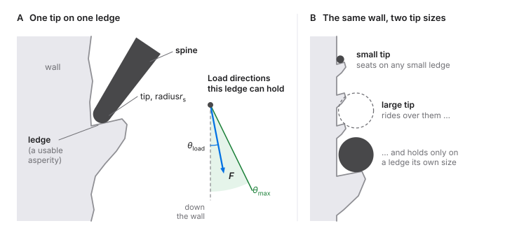

# Spine–asperity contact

Everything a spine array does is built from one event: a rounded steel tip comes to rest on a small ledge and is then pulled, mostly along the wall. This page looks at that single contact. The model and the measurements are from [Asbeck 2006][asbeck2006] and chapter 2 of [Asbeck 2010][asbeck2010].

*A: a tip of radius rs seated on a ledge. The ledge holds any load directed down the wall and up to θmax away from it. B: tip size decides which ledges count.*

## The geometric model

Take a profile of the wall along the direction the spine will be dragged. Model the spine tip as a circle of radius $r_s$ that approaches the wall at an angle $\theta_a$ and is then stroked down it.

- The tip cannot reach every point of the profile. A large tip bridges small pits, and a tip arriving at a shallow angle is shadowed by bumps. Rolling the tip circle over the profile, and recording where its centre goes, gives the *traced surface*: the wall as that particular spine sees it.
- At each point of the traced surface, let $\theta$ be the angle of its normal, measured from the outward normal of the wall. On a flat wall $\theta = 0$. On a perfect shelf, perpendicular to the wall, $\theta = 90^\circ$.
- A **usable asperity** is a stretch of traced surface that begins where $\theta$ exceeds a threshold $\theta_{min}$ and runs to the next local minimum. In plain terms: a shelf steep enough to hold the tip, with something behind it to stop the tip.

A tip sliding down the wall that drops into such a region keeps moving until it reaches the point where $\theta = \theta_{min}$, and stops there.

## The friction condition

Why is there a threshold? The tip is held by the normal force of the ledge and by friction. Pull on the spine at an angle $\theta_{load}$ away from the wall. The reaction the ledge must supply is tilted toward the wall by that same angle, and it must stay inside the friction cone around the ledge's normal. With a friction coefficient $\mu$ this requires

$$
\theta_{load} \le \theta_{max} = \theta - \arctan\!\left(\frac{1}{\mu}\right)
$$

so a load at angle $\theta_{load}$ can only use ledges with $\theta \ge \theta_{min} = \theta_{load} + \arctan(1/\mu)$.

The numbers are unforgiving. Steel on rock has $\mu$ between about 0.15 and 0.25, so $\arctan(1/\mu)$ is 76° to 81.5°. SpinybotII loaded its feet at 3.5° to 8° from the wall, which means it could only use ledges within about 4° to 9° of a perfect shelf: $\theta_{min}$ between 81° and 86.5°. A spine does not hang on roughness in general. It hangs on the small minority of features that are nearly shelves, or undercut.

Two consequences follow directly:

- **Pull more nearly parallel to the wall and more ledges qualify.** This is why spine feet are loaded in shear first and only then asked for adhesion.
- **Higher friction would help a great deal**, because it lowers $\theta_{min}$ and the number of ledges rises steeply as $\theta_{min}$ falls.

## What measured walls look like to a spine

Profiles of stone, concrete and sandpaper surfaces, 5 cm long, were measured with a stylus profilometer (2 µm tip, samples every 1 µm) or, for surfaces too rough for the stylus, a laser micrometer (64 µm spot). The model was then run over them for a range of tip radii and angles ([Asbeck 2010][asbeck2010], §2.2). The findings:

1. **Smaller tips find more ledges, roughly as $1/r_s$ per unit length.** Stone and concrete profiles follow this trend for small radii, as expected for surfaces that look similar at different magnifications. Per unit *area* of wall the count goes as $1/r_s^2$.
2. **Above some radius the ledges run out.** Cutting, polishing and wear remove large features, so the count falls much faster than $1/r_s$ at large radii. Every surface has a largest usable asperity size, which is an upper bound on useful spine size ([Which surfaces can be climbed](surfaces.md)).
3. **Sandpaper is different.** Its grains are all about one size, so shrinking the tip below that size gains little.
4. **The threshold angle matters enormously.** There are many features with moderately steep normals and very few near 90°. The count of usable asperities drops drastically as $\theta_{min}$ approaches 90°.
5. **The approach angle matters little** until the spine is nearly parallel to the wall. Results for $\theta_a$ of 0°, 45° and 65° were essentially the same; 80° gave fewer.
6. **Spacing between usable asperities is scattered.** Along a line it is described reasonably well by a gamma distribution; mean spacings of 1 to 3 mm were typical of the surfaces measured for a 10 µm tip and $\theta_{min} = 75^\circ$.

> [!IMPORTANT]
> Roughness numbers do not predict climbability. A painter's 100-grit sandpaper had larger average and RMS roughness than 120- and 150-grit aluminium-oxide papers, yet offered far fewer usable asperities at steep threshold angles because its grains are rounded. What counts is the local slope of the surface at the scale of the tip, not the height of the bumps.

## How real spines differ from the model

The model is two-dimensional and quasi-static. Real spines on a moving foot behave less tidily ([Asbeck 2010][asbeck2010], §2.2.3):

- Many spines briefly catch on features that cannot hold them and break away as the load ramps up. The tip may be rotating slightly as its suspension deflects, the feature may be a weak grain that snaps off, or it may be a shallow ledge that held only while the spine was still being pressed against the wall.
- After such a slip the spine skips, briefly airborne, and may pass over good ledges before it lands.
- Asperities are three-dimensional. A ledge that slopes sideways lets the tip slide off to the side, so the true count is somewhat below the two-dimensional estimate. Pits help: they steer a tip into a seat. Grooves hurt: a tip can follow one past protruding ledges.
- The stylus cannot see undercut ledges, with $\theta$ beyond 90°, which may be where many spines actually hold.

Despite all this, ranking surfaces by the simulated count of asperities per centimetre, with $\theta_{min}$ of 82° to 85° and radii of 10 to 40 µm, reproduced the order in which SpinybotII found those surfaces easy or hard to climb.

## Three ways a contact fails

When a steel spine is seated on an asperity and the load keeps rising, one of three things gives ([Asbeck 2010][asbeck2010], §2.3 and appendix A.1):

1. **The spine yields in bending** near its base. For a curved spine of diameter $d$ and effective length $l$ carrying a tip force $f$, the peak stress is essentially that of a cantilever, $\sigma_{max} = 32\,f\,l / (\pi d^3)$.
2. **The tip rotates elastically until it slips off.** The end rotation of a curved beam under a tip load scales the same way with size.
3. **The asperity breaks**, usually a grain coming loose from its matrix. Hertz contact theory puts the largest tensile stress at the rim of the contact patch, and for a given material strength the load at which that stress is reached grows as the square of the combined radius of curvature of tip and asperity.

If every dimension is scaled together, all three limits give a maximum load proportional to the **square of the spine's size**. That single fact, set against the $1/r_s^2$ supply of ledges, drives the [scaling argument](scaling.md) for using many small spines.

Which mode comes first depends on the wall. On sandpaper, whose grains stand proud on a small bonded footprint, the grain usually broke away before the spine was in trouble. On cast concrete, where the usable features are mostly pits with strong surroundings, the spine gave first, by tip rotation or plastic bending. On most other surfaces all three were seen.

The spines used on SpinybotII, with tips of 15 to 20 µm, held 1 to 2 N per contact. The earlier SpinybotI used tips of 30 to 50 µm that held several newtons each, usually limited by the asperity rather than the spine.

## Summary

- A ledge holds a spine only while the pull, reversed, lies within the friction angle $\arctan(\mu)$ of the ledge's normal. In practice that means near-perpendicular ledges and a pull close to parallel with the wall.
- The supply of such ledges rises as tips shrink, until the surface runs out of structure.
- The strength of one contact falls as the square of tip size.
- The limits on direction and magnitude together define a region in force space: the [limit curve](limit-curve.md).

[asbeck2006]: ../reference/bibliography.md#asbeck2006
[asbeck2010]: ../reference/bibliography.md#asbeck2010
