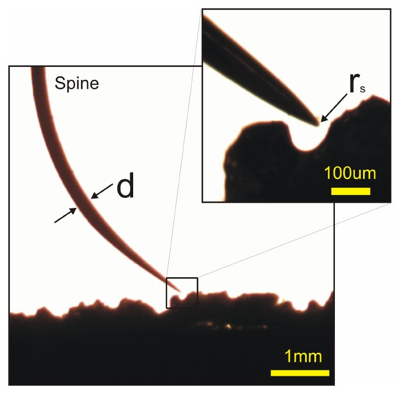
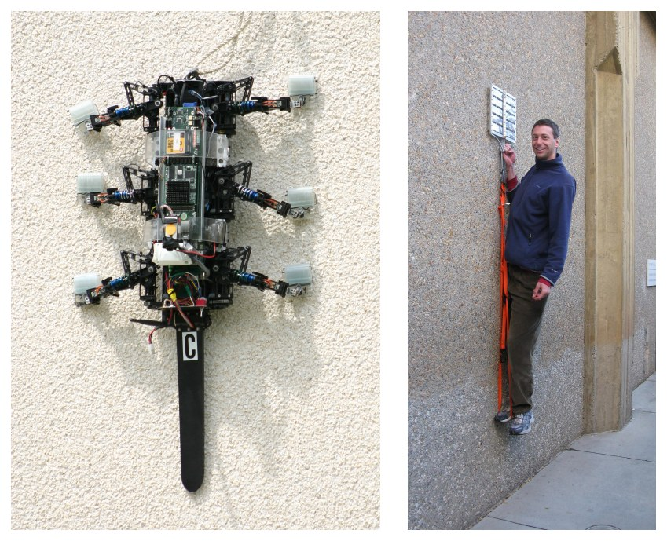

# What microspines are

A microspine is a small, sharp, hardened hook, typically a steel point with a tip radius of 10 to 35 µm, mounted on a compliant suspension. Many of them are used side by side. Dragged lightly down a rough surface, each tip finds a ledge of its own to rest on: an *asperity*. Once the tip is seated, the suspension stretches and the spine carries load along the wall and, to a smaller extent, away from it.

The idea was developed at Stanford's Biomimetics and Dexterous Manipulation Laboratory from about 2004, first for the Spinybot robots and then for the RiSE hexapod, a perching aircraft and human-scale climbing aids ([Asbeck 2006][asbeck2006]; [Asbeck 2010][asbeck2010]). The central reference for the design rules collected in this wiki is [Asbeck & Cutkosky 2012][asbeck2012].

*A spine with a 270 µm shaft and a 10 µm tip resting on the profile of rough concrete. Figure 2.1 of [Asbeck 2010][asbeck2010], © Alan T. Asbeck, [CC BY-NC-ND 3.0 US](https://creativecommons.org/licenses/by-nc-nd/3.0/us/).*

## Spines are not claws

A cat's claw works by penetrating bark or wood. A spine does not penetrate. It rests on a feature that is already there, so it works on hard materials such as concrete, brick, stucco and stone, as long as they offer ledges of about the tip's size or larger.

Animals use both. Many insects carry a pair of tarsal claws on each leg that catch surface roughness; cockroaches whose adhesive pads were removed could still walk up, and upside down on, rough emery paper using the claws alone, but not on finer grades ([Roth & Willis 1952][roth1952]). Beetle claws grip better as roughness grows relative to the claw tip ([Dai 2002][dai2002]). Geckos keep a small claw on each toe next to the adhesive pad and depend on it on very rough surfaces ([Mahendra 1941][mahendra1941]), and across lizards clinging ability on rough surfaces goes with claw shape ([Zani 2000][zani2000]). Squirrels climb brick and stucco.

An animal has a handful of claws per foot, so claw size has to grow with body mass. A microspine array breaks that link: it carries a large load on a large number of small spines. That is why a 3.8 kg robot can climb surfaces smoother than an animal of the same mass could, and it is also why **load sharing** between spines is the central design problem of this whole subject.

## How spines compare with other ways of holding on

| Method | Surfaces | Holding costs power? | Dust and moisture | Typical weakness |
|---|---|---|---|---|
| Microspines | Rough and hard: concrete, brick, stucco, stone, roofing felt | No | Tolerant | Nothing to hold on smooth surfaces |
| Penetrating claws | Soft: bark, wood, cork, carpet | No | Tolerant | Cannot enter hard surfaces |
| Dry (gecko-like) adhesives | Smooth: glass, painted metal, polished stone | No | Fouled by dust | Little contact on rough surfaces |
| Suction | Smooth and airtight | Yes, or slowly leaks | Leaks on dust and pores | Fails on porous or cracked walls |
| Magnets | Ferromagnetic only | No (permanent) | Tolerant | One material |
| Vortex or thrust | Most | Yes, continuously | Tolerant | Power, noise |

The first three share one property that matters for control. Their adhesion is *directional*: it exists only while the contact is also loaded in shear, grows with that shear, and vanishes when the load is relaxed. See [Force space and the limit curve](limit-curve.md).

## What you get

- **Almost no preload.** Ten RiSE toes needed about 0.04 N pressing into a roofing-paper surface before they produced about 5 N of adhesion, a ratio above 100; even pressed in perpendicularly the ratio was 25 ([Asbeck 2010][asbeck2010], §4.6). Gecko setae manage 8 to 16.
- **No force to let go.** Relax the shear load and the spines lift off. There is no peel force and no jolt.
- **Holding is free.** A loaded spine is a hook on a ledge. It needs no power, and it is silent.
- **Dirt does not matter much.** Spines keep working on dusty exterior walls and are only moderately affected by moisture.
- **Slips are survivable.** When one spine lets go, the others keep holding and the free one usually catches again a little farther down. Ten toes dragged 4 to 6 cm across roofing paper, several times the travel of any one of them, never lost adhesion completely ([Asbeck 2010][asbeck2010], §4.7).

## What it costs

- **The wall must be rough at the right scale.** A spine cannot use a feature much smaller than its tip. Smooth panels, glazed tile and painted-over texture offer few or none.
- **Adhesion comes only with shear.** A spine can pull into the wall only within some angle of the wall, typically 20° to 45° on a surface like stucco. A foot that must pull straight outward needs a second array pulling against the first ([Opposed spines and grippers](../design/opposed-spines.md)).
- **Holding is statistical.** Only a fraction of the spines in an array find a ledge on any one placement, usually between a fifth and a half, and each ledge has its own strength. Designs are sized on averages and margins.
- **Each spine carries little.** A contact at this scale holds on the order of 1 N before the tip bends or the asperity breaks, so large loads need hundreds or thousands of spines ([Scaling](scaling.md)).
- **Walls and tips wear.** Weak asperities break off, and tips dull from about 10 µm to tens of micrometres with use.

## Three scales that have been built

| System | Mass | Spines | Source |
|---|--:|--:|---|
| Perching aircraft | 0.4 kg | 10 | [Asbeck & Cutkosky 2012][asbeck2012], Fig. 1 |
| RiSE climbing hexapod | 3.8 kg | 192 | same |
| Person hanging from a wall | 84 kg | 1200 | same |

All three used the same toe mechanism, described in [Toe designs](../design/toe-designs.md).

*Left, the RiSE robot on a wall. Right, the thesis author hanging from a patch of 1200 Z-Man toes. Figure 4.1 of [Asbeck 2010][asbeck2010], © Alan T. Asbeck, [CC BY-NC-ND 3.0 US](https://creativecommons.org/licenses/by-nc-nd/3.0/us/).*

## Where to go next

- How a single tip holds, and when it fails: [Spine–asperity contact](spine-asperity-contact.md).
- Whether your wall will work: [Which surfaces can be climbed](surfaces.md).
- How to make hundreds of spines share a load: [What the suspension must do](../design/suspension-requirements.md), then [Load sharing](../design/load-sharing.md).
- How to build and measure a toe: [Building spine toes](../fabrication/building-toes.md) and [Test methods](../testing/test-methods.md).

[asbeck2006]: ../reference/bibliography.md#asbeck2006
[asbeck2010]: ../reference/bibliography.md#asbeck2010
[asbeck2012]: ../reference/bibliography.md#asbeck2012
[roth1952]: ../reference/bibliography.md#roth1952
[dai2002]: ../reference/bibliography.md#dai2002
[zani2000]: ../reference/bibliography.md#zani2000
[mahendra1941]: ../reference/bibliography.md#mahendra1941
