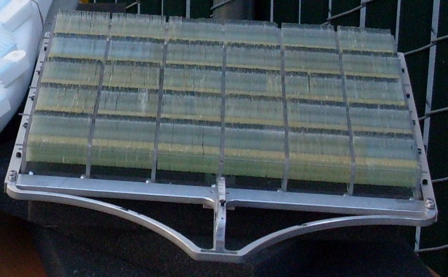
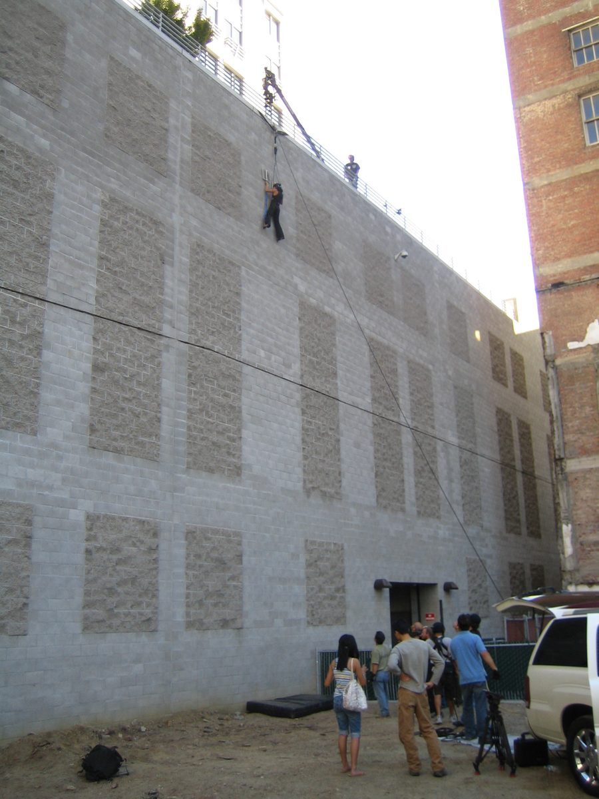
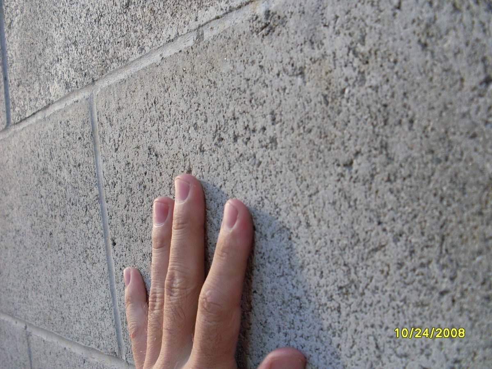

# Spine paddles on a five-storey wall, 2008

In 2008 the Discovery Channel series *Prototype This!* set out to build devices with which a person could climb a smooth and a rough vertical wall ([Prototype This! 2009][prototype-this]). The laboratory built both halves: paddles of directional dry adhesive for glass, and paddles of spines for rough walls. This page is about the spine paddles. With them, a professional climber climbed a five-storey building. The episode, "Geckoman", was first shown on 19 March 2009 ([BDML media list][bdml-media]).

> [!NOTE]
> Most of this page comes from the laboratory's internal review of the project, written to record lessons for its Z-Man work and never published ([BDML 2008 (internal review)][bdml2008-discovery]). The paddles were built quickly, for television. Treat the numbers as single observations, not as measured performance.

## The paddles

*One of the two spine paddles. Photograph: Stanford BDML, October 2008.*

- About 1350 toes per paddle, in five rows of about 270.
- The toes were thicker than the Z-Man toes made at Stanford in the summer of 2007: about 1 mm on average, against about 0.75 mm. Thicker toes meant fewer of them, and faster manufacture.
- The toes were slotted into aluminium channels and fixed rigidly to the paddle. The handle was welded on.
- A set screw in the handle acted as a spur at the bottom of the paddle.
- Each paddle weighed about 4 lb (1.8 kg).

The thesis calls these the Z-Man climbing paddles: the paddle in its Figure 5.2 is of the same design ([Asbeck 2010][asbeck2010]; [Arrays, feet and large patches](../design/arrays-and-patches.md#several-rows-the-alignment-problem)).

## Loaded through the feet

The paddles were placed with the hands but loaded through the feet. A length of climbing webbing ran from each paddle down to a loop around the foot, so the legs did the lifting. Because the foot was about 1.5 m (5 ft) below the paddle, the webbing pulled the paddle down the wall almost parallel to it, with very little force normal to the surface. That is the direction in which spines hold best ([Force space and the limit curve](../fundamentals/limit-curve.md)).

*Partway up the wall. Blue webbing runs from each paddle to a loop around the climber's foot. Photograph: Stanford BDML, 2008.*

The arrangement had costs:

- The webbing was a fixed length, so the right hand and right foot had to move together, and likewise the left. A retractable leash that would have decoupled hand and foot was considered but left out, for simplicity and lack of time.
- At every step one paddle carried the climber's whole weight.
- The climber had to keep their balance to avoid putting unwanted moments on the paddles.

The review recommends a pegboard for trying out such arrangements. It let the team experiment with webbing and with ways of loading each contact point without any spines involved.

## The climb

*The climb, sped up four times and without sound. Video: Stanford BDML, 2008.*

A professional climber of about 59 kg (130 lb) climbed a five-storey building on the paddles, slipping once, about halfway up. The review calls the building brick; the video shows a wall of concrete block, with panels of split-face block.

*Near the top of the building. Photograph: Stanford BDML, 2008.*

Afterwards several more people, up to about 84 kg (185 lb), each took five to ten steps on the paddles, until they were too high to go on without the safety line.

*Others try the paddles. Video: Stanford BDML, 2008.*

What the climber reported:

- **Climbing was quick and efficient.** The most tiring part was placing the paddles, because the handle was awkward to manipulate.
- **The legs did the work.** The climber never tired and could rest comfortably at any step. It was even possible to take both hands off the wall, to adjust a strap or pose for a photograph.
- **The webbing pinched the feet.** Flexible climbing shoes folded under the load. Stiff shoes, or a platform in place of the webbing loop, would help.

## What one paddle held

| Surface | Load held by one paddle |
|---|---|
| Rough, porous brick | a person of 84 kg (185 lb), moving; probably more than 91 kg (200 lb) |
| Unfinished cinder block | more than 68 kg (150 lb), possibly much more |
| Red brick at a naval base | more than 68 kg (150 lb) |
| Heavily painted, undulating brick | 23 kg (50 lb) |
| Stucco | failed at a modest load: the spines broke the asperities off |

*The wall that was climbed, with a hand for scale. Photograph: Stanford BDML, October 2008.*

As a rough check, which is the wiki's own arithmetic and not the review's: 84 kg on 1350 toes is 0.6 N per toe on average, or about 2 N per working spine if a third of them were engaged. That is the same loading as the 84 kg hang from 1200 toes described in [Human-scale climbing](human-scale-climbing.md#a-patch-of-1200-toes), and close to the limit of what one contact holds.

The review's view of surfaces: the paddles worked very well on porous brick, cinder block and mortar joints, but many other surfaces that look rough, or rough under paint, would need many more spines to carry a person. A design for one wall is not a design for walls in general. For very rough surfaces it suggests going the other way, with fewer, wider spines on sturdier hooks: "think tuna, not bluegill".

## What went wrong: the bottom rows

During the climb the bottom one or two rows of toes often let go. The pull on the handle had an outward component at the bottom of the paddle. That turned the paddle about its upper rows: the top rows were pressed into the wall, which helped, and the bottom rows were pulled off it.

The review suggests three fixes:

- a slightly flexible rotational joint where the load is applied;
- a longer distance between the bottom row of spines and the loading point;
- a wider, shorter paddle, with longer rows and fewer of them, so that every row engages. Two wide paddles might get in each other's way, so the climber might have to move one over the other.

The thesis takes up the same observation and analyses where to put the joint so that the load presses a patch onto the wall instead of peeling it ([Arrays, feet and large patches](../design/arrays-and-patches.md#the-patch-as-a-mechanics-problem)).

## The smooth-surface paddles

The paddles for glass used patches of directional dry adhesive on independently articulating tiles. They are outside the scope of this wiki. The review's main lesson from them also applies to spines: when a climber spreads their weight over many contacts by hand, they cannot feel which contact is about to fail, so sensing, or automatic tensioning of the webbing, would help.

[asbeck2010]: ../reference/bibliography.md#asbeck2010
[bdml2008-discovery]: ../reference/bibliography.md#bdml2008-discovery
[bdml-media]: ../reference/bibliography.md#bdml-media
[prototype-this]: ../reference/bibliography.md#prototype-this
