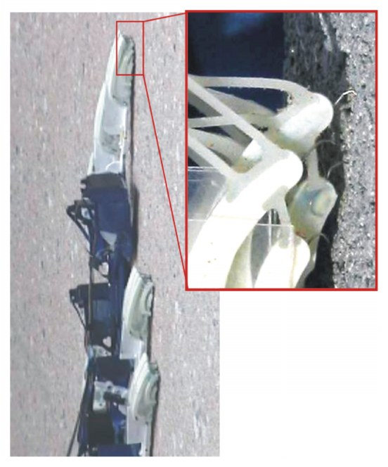

# Spinybot

Spinybot is where compliant microspine arrays began. Built at Stanford and first reported in 2005, it showed that a small robot could climb concrete, brick, stucco and masonry walls with nothing but arrays of tiny spines, each on its own soft suspension ([Asbeck 2005][asbeck2005]; [Kim 2005][kim2005]; [Asbeck 2006][asbeck2006]).

*The upper section of SpinybotII on a concrete wall, and several of its spines engaging separate asperities. Figure 2.7 of [Asbeck 2010][asbeck2010], © Alan T. Asbeck, [CC BY-NC-ND 3.0 US](https://creativecommons.org/licenses/by-nc-nd/3.0/us/).*

## Two generations

| | SpinybotI | SpinybotII |
|---|---|---|
| Spines per foot | 4 | 20: ten toes with two spines each |
| Tip radius | 30–50 µm | 12–25 µm |
| Load per contact | several newtons | 1–2 N |
| Surfaces | stucco, rough concrete | concrete, brick, stucco, masonry |

(The thesis gives SpinybotII's tip radius as 15–20 µm; the figure above is from the 2006 short paper.)

The first machine used a few relatively large spines. Each held well, but on smoother surfaces there were too few ledges large enough for them within the 2 cm stroke of a foot. The second used many more, finer spines. Each held less, the suspension shared the load between them, and the range of climbable surfaces grew. This trade is the origin of the [scaling argument](../fundamentals/scaling.md).

## SpinybotII in numbers

| | |
|---|--:|
| Mass | 0.4 kg |
| Maximum payload | 0.4 kg |
| Climbing speed | 2.3 cm/s |
| Toes per foot | 10 |
| Spines per toe | 2 |
| Spine shaft diameter | 200 µm |
| Spine tip radius | 12–25 µm |
| Toe materials | urethanes of 75 Shore D and 20 Shore A |

Mass, payload, speed and toes per foot are from Table II and §III of [Kim 2005][kim2005] (authors' copy); spines per toe and spine dimensions from [Asbeck 2006 (video)][asbeck2006video].

On most surfaces it could climb, 30 to 40 % of SpinybotII's spines were engaged at any moment, and its feet were loaded at only 3.5° to 8° from the wall ([Asbeck 2010][asbeck2010], §2.2.2 and §2.3). It could hang from a wall without consuming power.

## What it established

- **Non-penetrating spines work on hard building materials**, where claws, suction and the adhesives of the day did not.
- **Compliance per spine is the enabling idea.** Each toe is a small elastic linkage, soft normal to the wall and stiffer along it.
- **Profile measurements predict which surfaces are climbable.** The asperity-counting model was checked against SpinybotII's performance on stone and sandpaper samples ([Which surfaces can be climbed](../fundamentals/surfaces.md)).
- **The design scales.** The same papers work out how toe compliance must change with robot mass, tip radius and the number of toes, which made the step to RiSE, nearly ten times heavier, possible.

The design is covered by a US patent filed in December 2005 and granted in 2011 ([patent][patent-us8066088]).

## Further reading

The laboratory's original [Spinybot page](https://bdml.stanford.edu/twiki/bin/view/Rise/SpinyBot.html), with photographs and videos, is still online on the old BDML wiki.

[asbeck2005]: ../reference/bibliography.md#asbeck2005
[kim2005]: ../reference/bibliography.md#kim2005
[asbeck2006]: ../reference/bibliography.md#asbeck2006
[asbeck2006video]: ../reference/bibliography.md#asbeck2006video
[asbeck2010]: ../reference/bibliography.md#asbeck2010
[patent-us8066088]: ../reference/bibliography.md#patent-us8066088
