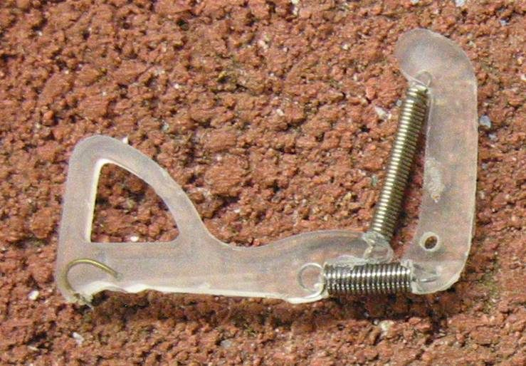
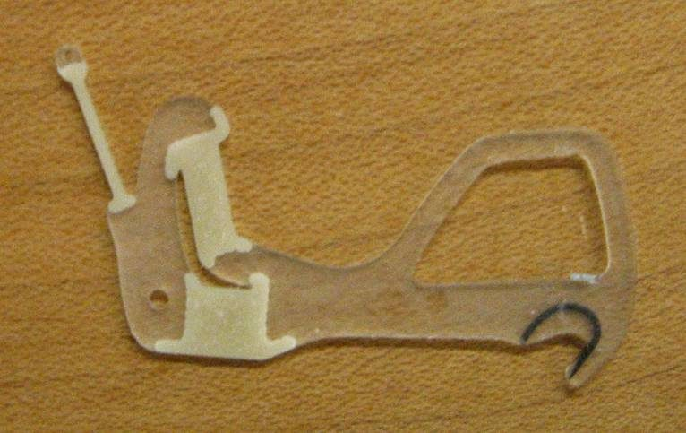
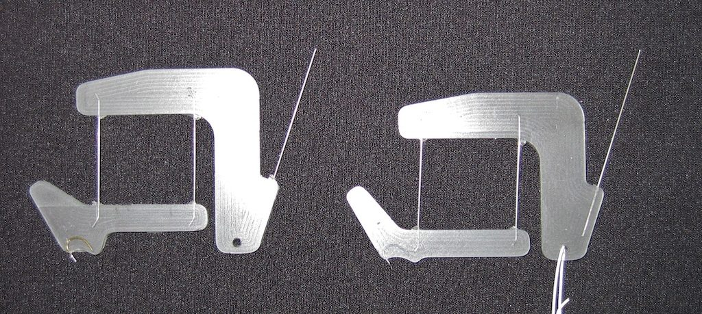
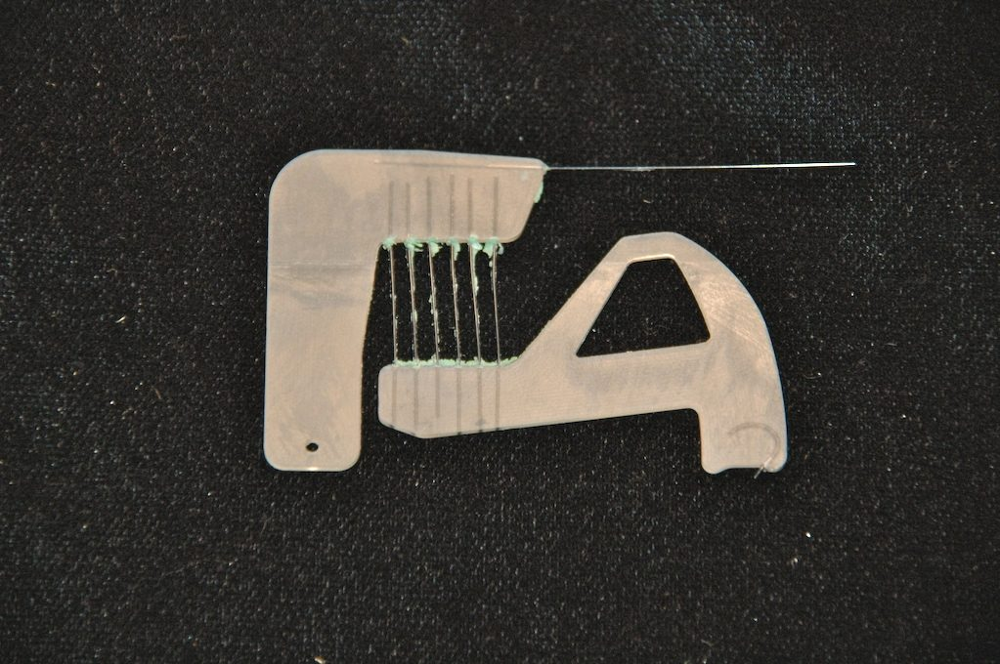
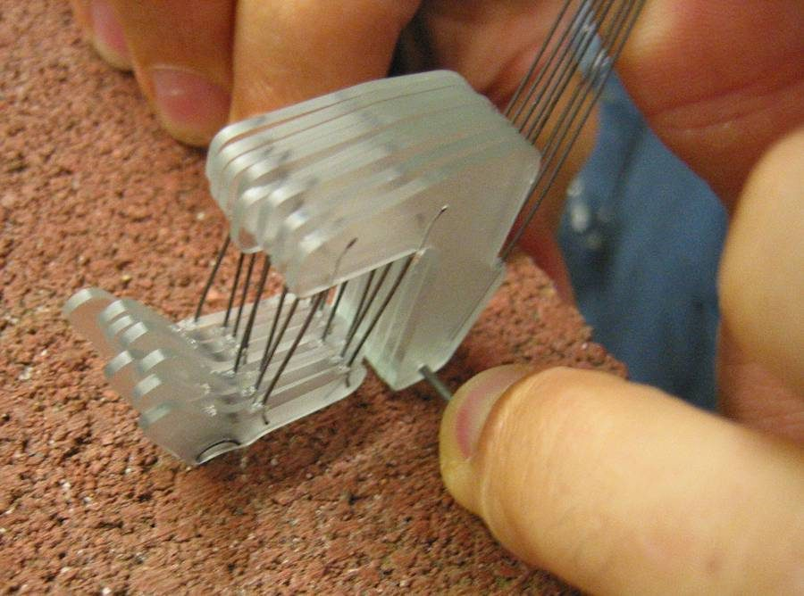
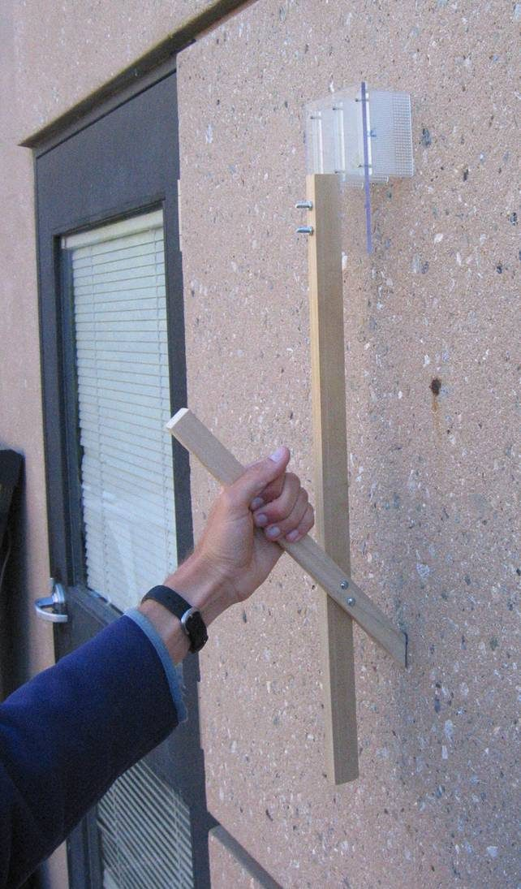
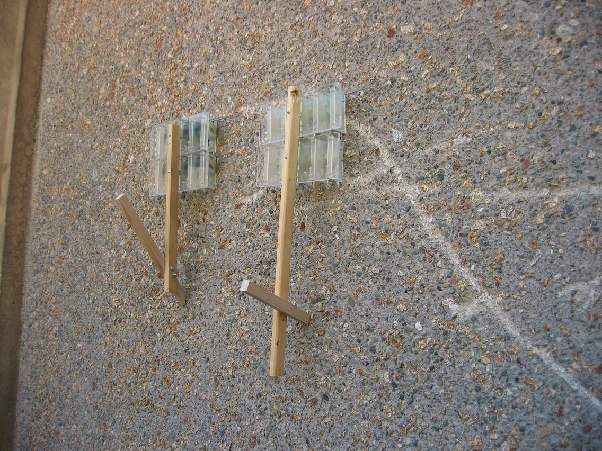

# Human-scale prototypes, 2007

When the laboratory began work on human climbing in 2007, the largest proven spine toe was the RiSE toe, made for a robot of 3.8 kg. A person is about twenty times heavier. Over the summer the group tried several new toes and a hand-held mount, and in October people hung from a real wall for the first time. This page collects what the laboratory's project wiki records of that work.

> [!NOTE]
> The sources are working documents: slides prepared for weekly calls, a summer student's log and a short report ([Asbeck 2007 (slides)][bdml2007-toe-design]; [BDML 2007 (slides)][bdml2007-prototypes]; [Asbeck 2007][bdml-outside-testing]). The numbers come from single tests.

## Rules of thumb for a spiny toe

In July 2007 Alan Asbeck set down principles for designing toe linkages, illustrated with simulations in a two-dimensional rigid-body package ([Asbeck 2007 (slides)][bdml2007-toe-design]):

- **Load along the wall first, then turn toward the working angle.** A spine loaded parallel to the wall, and only then pulled away from it, catches far more asperities than one pulled away from the wall from the start. The few that a spine does catch that way hold well, but there are few of them.
- **Watch how the spine turns on the way.** Whatever the linkage, the force on a loaded spine ends up along the direction of loading. What differs is the path. A moment that turns the tip into its ledge while the load builds, an *engaging* moment, gives a more secure hold. A *disengaging* rotation should be kept small.
- **Keep the force from overshooting.** Ideally the force on the spine starts nearly parallel to the wall and reaches the final loading angle without passing it.
- **Remote-centre compliance helps.** With a tension-only element such as a cord, and a link at the right angle, the linkage has a remote centre of compliance, and the spine's rotation under load becomes an engaging one.
- **Build it.** The simulations ignored how toes are really loaded, being pressed in while they are dragged, so built prototypes give more realistic answers.

The same slides modelled the hand as a mechanism that can translate but not rotate, because a gloved hand can apply moments to whatever it holds.

The later analysis of loading lines and the stalk model makes these ideas quantitative ([Load sharing](../design/load-sharing.md); [The stalk model](../design/stalk-model.md)).

## Toes tried in the summer of 2007

 

*Left: a toe with coil springs as flexures. Right: a cast two-material toe. Photographs: Stanford BDML, August 2007.*

| Design | What the slides record |
|---|---|
| Toe with a coil spring as its flexure | held up to about 4 lb (18 N) |
| Spring-steel toe | made 1.5 mm thick so that it would not crack |
| Toe with nitinol-wire flexures | no plastic deformation, but a small load capacity at first |
| Toes with embedded wire flexures: three variants, 1.5 mm thick, with wires 0.45 mm in diameter and 20 mm long | about 6 mm of travel at 6.5 N; permanent deformation from about 10 N; too stiff normal to the wall; five toes held about 30 N on brick |

Two lessons from the wire-flexure toes carried forward. Steel fishhooks were much better than bronze ones, and most of the 30 N had been carried by the toes with steel hooks ([BDML 2007 (slides)][bdml2007-prototypes]).

*Toes with embedded wire flexures. Photograph: Stanford BDML, August 2007.*

### Nitinol-wire toes

A later version used superelastic nitinol wire as the flexures, in diameters of 0.25 and 0.38 mm (0.010 and 0.015 in), in a toe 1 mm thick. It left 4 mm of clearance for a layer of dry adhesive.

- It worked between 5° and 12° from the wall, with 12 mm of travel.
- Each toe carried about 1 kg before it began to pitch back, without failing.
- An array of 16 toes held 4 to 6 kg, which is 250 to 375 g per spine.

The parallel four-bar toe described in the thesis uses the same two wire sizes ([Toe designs](../design/toe-designs.md#parallel-four-bar-toe)).

 

*Left: a toe with nitinol-wire flexures. Right: a group of wire-flexure toes on a test surface. Photographs: Stanford BDML, 2007.*

## The "ice axe"

The toes were mounted in patches on a hand-held "ice axe": a bar with the patch at its top and a handle lower down. The handle barely touches the wall. That gives the climber a reference and keeps the spines loaded in the right direction ([BDML 2007 (slides)][bdml2007-prototypes]).

*A prototype "ice axe". Photograph: Stanford BDML, August 2007.*

## First hang tests, October 2007

A short report on the laboratory's wiki describes the first outdoor test ([Asbeck 2007][bdml-outside-testing]). People did pull-ups on a pebbly wall outside the laboratory, holding two ice axes. One carried two patches of cast toes, of a design by a summer student; the other carried two patches of nitinol-wire toes.

*The two ice axes on the wall. Photograph: Stanford BDML, 1 October 2007.*

- The rig supported a person of about 145 lb (66 kg) for about 30 seconds at a time, and probably could have for longer. People of about 170 lb (77 kg) could not be held.
- The cast toes worked extremely well, carrying about two thirds of the weight: roughly 47 lb (21 kg) per patch, against an estimated requirement of 64 lb (29 kg). The nitinol toes were reaching their overload stops too early, and new side plates were being made to fix that.
- A shower of small rock fragments came down the wall, so the testers wore goggles. When a patch failed and scraped down the wall, the noise brought people out of the building.
- Some toes were slightly dulled. The patches and axes were larger and heavier than they needed to be.

*A hang test. Video: Stanford BDML, October 2007.*

Later came a patch of 1200 toes ([Human-scale climbing](human-scale-climbing.md#a-patch-of-1200-toes)) and, in 2008, a pair of climbing paddles ([Spine paddles on a five-storey wall](discovery-paddles.md)). The summer student's day-by-day log of making these toes is described in [Building spine toes](../fabrication/building-toes.md#the-sdm-sequence).

[bdml2007-toe-design]: ../reference/bibliography.md#bdml2007-toe-design
[bdml2007-prototypes]: ../reference/bibliography.md#bdml2007-prototypes
[bdml-outside-testing]: ../reference/bibliography.md#bdml-outside-testing
