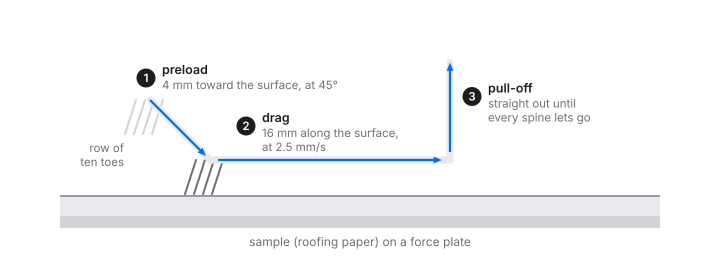
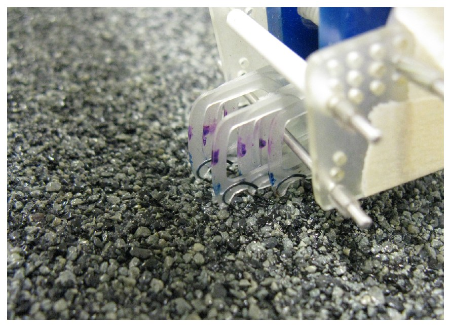

# Test methods

Spine arrays are statistical devices on irregular surfaces, so measurement carries more weight than calculation. The methods here are those behind the published data on the RiSE toe ([Asbeck 2010][asbeck2010], §§2.4, 4.2.3 and 4.6; [Asbeck & Cutkosky 2012][asbeck2012], §5). They need a positioning stage and a force sensor, and they scale down to a hand-held version.

## The rig

A row of toes is held on a motorised stage above a sample fixed to a force plate. The stage moves the base of the toes along a programmed path; the plate records the force on the sample.

| Item | Published rig |
|---|---|
| Motion | three-axis motorised stage, positioning accuracy ±20 µm |
| Force | force plate under the sample, accuracy about 25 mN |
| Specimen | ten toes in a row, on their pins and side plates |
| Speed | 2.5 mm/s for the surface tests |

The stage should be stiff compared with the toes, so that the motion you command is the motion the base makes. Record both force components and the stage position against time. A camera on the toes is worth having: many features of a force trace only make sense once you have seen which spine did what.

## Characterising a linkage

The first test removes the surface from the problem. Glue a thin bar, 1.6 mm in diameter in the published tests, across the sample plate, so that every spine in the row catches on it at the same place.

1. Position the row so the spine tips are just behind the bar.
2. Move the base toward the plate by a chosen **preload depth**. The tips slide back along the plate as the toes rotate.
3. Drag the base parallel to the plate, 8 mm in the published tests. All the spines catch on the bar and the toes stretch together.
4. Reverse the path.
5. Repeat for a range of preload depths, for example 0 to 6 mm.

Plot normal force against shear force for the drag at each preload depth. Each curve is a [loading line](../design/load-sharing.md#loading-lines), and the set of them is the signature of the suspension. Divide the forces by the number of toes for per-spine values. This is the test that the [stalk model](../design/stalk-model.md) is fitted to.

What to look for:

- Do the lines pass near the origin and fan out radially?
- Which way do they curve?
- What is the normal force at the start of each line? That is the force with which a freed spine would press on the wall.
- How large is the loop between loading and unloading? That is the hysteresis of the flexures.
- At which preload does a hard stop come into play? The line kinks toward shear when the overload pin touches its window.

Repeat with the row mounted at different angles to the surface if the angle is still a design variable.

## Testing on a surface

*The preload–drag–pull-off trajectory, with the values used for the roofing-paper tests.*

The second test uses a real surface. The published one was roofing paper, which has a roughness close to stucco (about 204 µm RMS), cuts to size and mounts flat. Its granules pull out easily, so for some tests it was coated with a thin layer of cyanoacrylate glue ([Which surfaces can be climbed](../fundamentals/surfaces.md#weak-surfaces)).

1. **Preload.** Move the base toward the surface at 45° to a depth of 4 mm, about half the working range of the toes.
2. **Drag.** Move it 16 mm parallel to the surface. This is deliberately longer than the 9 to 11 mm travel of a toe, so that spines reach their overload stops, release and re-engage during the drag.
3. **Pull off.** Move it straight away from the surface until every spine has let go.

Use a fresh patch of surface for each trial, or accept that the surface is being worn.

*RiSE toes on roofing paper. Some spines are engaged and near the end of their travel; others have just caught. Figure 4.25 of [Asbeck 2010][asbeck2010], © Alan T. Asbeck, [CC BY-NC-ND 3.0 US](https://creativecommons.org/licenses/by-nc-nd/3.0/us/).*

### Reading a force trace

*Forces on ten RiSE toes during one trial. Red: shear. Blue: normal, negative when the toes pull on the surface. Figure 4.26 of [Asbeck 2010][asbeck2010], © Alan T. Asbeck, [CC BY-NC-ND 3.0 US](https://creativecommons.org/licenses/by-nc-nd/3.0/us/).*

A trace like this one can be read spine by spine.

- **During the preload** the normal force is barely visible: about 0.04 N for ten toes on this angled approach. A few spines have already caught by the end of it.
- **The slope steepens (1).** Each engaged toe adds force at a nearly constant rate as the base moves. When the slope of the trace increases, another spine has caught. A stretch of constant slope means no change in the number engaged.
- **A spike, then a drop (2).** A spine has reached its overload stop. The stop pries it away from the wall, so for a moment force rises, and normal force rises faster than shear; then the spine lets go and the force drops by what that spine was carrying.
- **A drop with no spike.** Something failed without warning: usually a granule pulling out of the surface.
- **During pull-off (3)** the same stop acts in the normal direction. Adhesion rises sharply, spines release one after another, and the force returns to zero. Jumps in normal force with no change in shear belong to this phase.

Plot the same data in force space and the drag phase lies along a single loading line, with excursions only at the releases.

### Dynamic adhesion

To see whether an array keeps holding while individual spines come and go, preload it and then drag it at constant height for several times the travel of one toe: 4 to 6 cm in the published tests. Report the *minimum* adhesion and shear during the drag, not the peaks. Ten RiSE toes held at least 1 N of adhesion and 2.5 N of shear over 4 cm ([Load sharing](../design/load-sharing.md#re-engagement-and-dynamic-adhesion)).

## Mapping a limit curve

To find what an array can hold on a surface, as opposed to what it does on one path:

1. Choose a set of preload depths (the published set was 1.5, 4.0 and 6.5 mm) and a set of directions for the loading move, from parallel to the surface to steeply away from it.
2. For each combination, run several trials on fresh surface.
3. From each trial take the point of largest force.
4. Plot the points in force space.

The cloud of points outlines the [safe region](../fundamentals/limit-curve.md#a-measured-limit-curve). Draw two rays from the origin that enclose most of the points limited by slipping: the shallower is a conservative adhesion limit, the steeper an upper bound. Draw an arc for the strength limit in the same way. Expect scatter. It narrows as the number of spines in the specimen grows.

## Simpler tests

Not every question needs a stage.

- **Single spine on a stiff link.** Drag one spine by hand, or on a spring balance, to estimate asperity spacing, limiting angle and contact strength ([Which surfaces can be climbed](../fundamentals/surfaces.md#judging-a-new-surface)).
- **Hang test.** Load a foot or patch with dead weight on the real wall. This tests the whole chain, including alignment and the way the load is applied. Add weight in steps and note the direction of the load line.
- **Pull test with a force gauge.** Vary the angle of the pull to probe the adhesion limit.

For a hang test with a person, use a belay or a crash pad and wear eye protection: spines throw grit when they release.

## Surface profiles

If you want to predict rather than measure, record profiles of the surface along the drag direction. The original study used a stylus profilometer with a 2 µm tip for stone and sandpaper and a laser micrometer with a 64 µm spot for rough concrete, over 5 cm ([Spine–asperity contact](../fundamentals/spine-asperity-contact.md#what-measured-walls-look-like-to-a-spine)). Two cautions from that work: an instrument with a finite tip or spot cannot see steep or undercut ledges, which are the ones that matter; and average roughness values computed from the profile do not predict performance.

## What to report

So that results from different groups can be compared, give:

- the surface, how it was prepared, and whether each trial used fresh surface;
- the spines: type, tip radius if measured, and how worn;
- the number of toes and their mounting angle;
- the trajectory: preload depth and direction, drag length, speed, pull-off direction;
- peak shear and peak adhesion, as totals and per spine, with the angle of the force at the peak;
- the number of trials and the spread, not only the best result;
- the fraction of spines engaged, if it was observed;
- the preload force, and the ratio of peak adhesion to preload;
- what limited the force: slipping, overload stops, or the surface.

[asbeck2010]: ../reference/bibliography.md#asbeck2010
[asbeck2012]: ../reference/bibliography.md#asbeck2012
